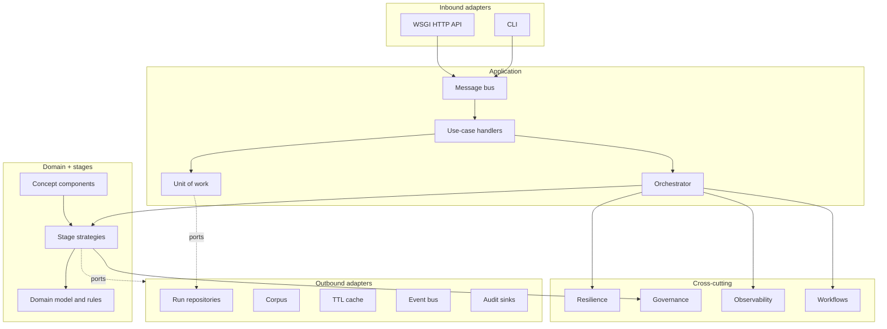
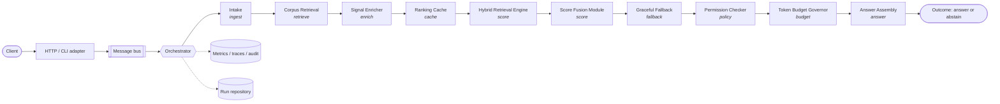
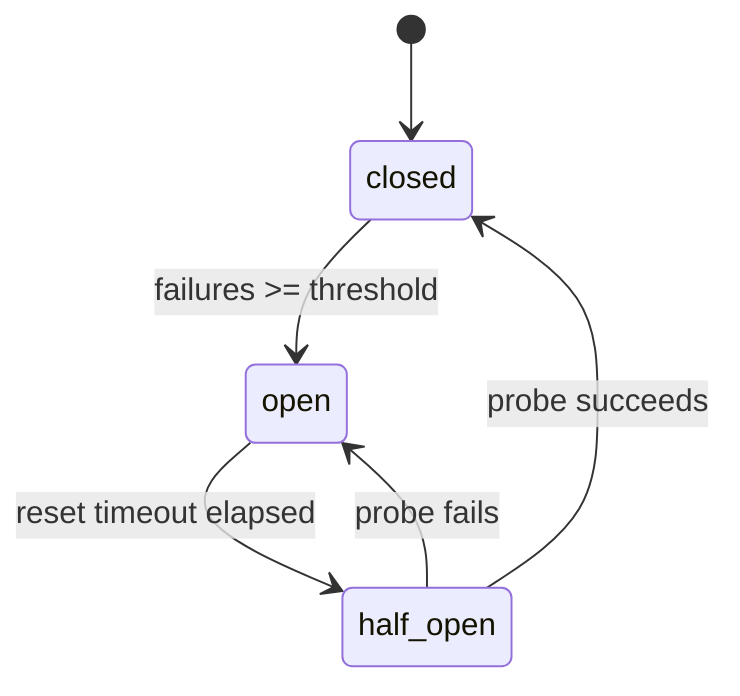
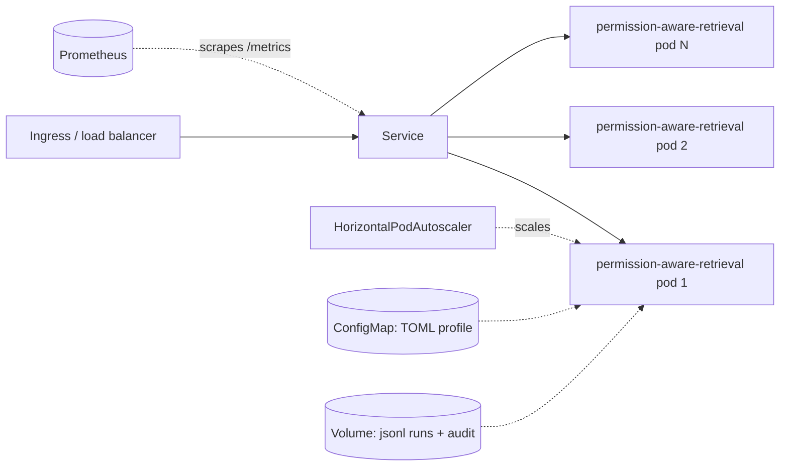

# Permission-Aware Retrieval

Enforce document access before context assembly.

> Part of the series **From RAG to Governed Enterprise Agents**.

[](.github/workflows/ci.yml)


A production-shaped reference implementation of **Permission-Aware Retrieval**. It is built as a
hexagonal (ports and adapters) service with a pluggable stage pipeline, fail-closed
governance, layered resilience, and first-class observability. The runtime uses
only the Python standard library, so every behaviour in this README can be run and
tested on a laptop in seconds.

## Contents

- [Why this exists](#why-this-exists)
- [Architecture at a glance](#architecture-at-a-glance)
- [Pipeline stages](#pipeline-stages)
- [Components](#components)
- [Quick start](#quick-start)
- [HTTP API](#http-api)
- [Configuration](#configuration)
- [Governance model](#governance-model)
- [Resilience model](#resilience-model)
- [Observability](#observability)
- [Design trade-offs](#design-trade-offs)
- [Failure modes](#failure-modes)
- [Project layout](#project-layout)
- [Testing strategy](#testing-strategy)
- [Extending the pipeline](#extending-the-pipeline)
- [Deployment](#deployment)
- [Provenance and validation](#provenance-and-validation)
- [Limitations](#limitations)

## Why this exists

Enforce document access before context assembly.

Most write-ups of this pattern stop at a box diagram. This repository goes further:
every box is a module, every arrow is a port, and every failure mode named in the
design has a test that injects it.

## Architecture at a glance

Pattern: **Pre-Retrieval Permission Filtering**.



Dependency rule: arrows point inward. `kernel` depends on nothing; `domain` depends
on `kernel`; `stages` and `components` depend on `domain`; `application` composes
them; adapters sit at the edge. Only `container.py` knows every concrete class.

### Request flow



### Data flow

See [docs/architecture/data-flow.md](docs/architecture/data-flow.md).

## Pipeline stages

The default order is generated from the architecture specification and sorted by
role so the pipeline is always semantically valid (ingest first, policy before
release, answer last). Override it with `pipeline.stages` in any profile.

| # | Stage | Role | Critical | Source |
|---|---|---|---|---|
| 1 | `intake` (Intake) | `ingest` | yes | built-in |
| 2 | `corpus_retrieval` (Corpus Retrieval) | `retrieve` | no | built-in |
| 3 | `signal_enricher` (Signal Enricher) | `enrich` | no | [component](docs/components/signal_enricher.md) |
| 4 | `ranking_cache` (Ranking Cache) | `cache` | no | [component](docs/components/ranking_cache.md) |
| 5 | `hybrid_retrieval_engine` (Hybrid Retrieval Engine) | `score` | no | [component](docs/components/hybrid_retrieval_engine.md) |
| 6 | `score_fusion_module` (Score Fusion Module) | `score` | no | [component](docs/components/score_fusion_module.md) |
| 7 | `graceful_fallback` (Graceful Fallback) | `fallback` | no | built-in |
| 8 | `permission_checker` (Permission Checker) | `policy` | yes | [component](docs/components/permission_checker.md) |
| 9 | `token_budget_governor` (Token Budget Governor) | `budget` | no | [component](docs/components/token_budget_governor.md) |
| 10 | `answer_assembly` (Answer Assembly) | `answer` | yes | built-in |

## Components

| Component | Role | Responsibility |
|---|---|---|
| [Permission Checker](docs/components/permission_checker.md) | `policy` | Fail-closed tenant, clearance, and ACL filtering plus PII redaction. |
| [Hybrid Retrieval Engine](docs/components/hybrid_retrieval_engine.md) | `score` | Blends upstream prior scores with query-aware relevance and reorders candidates. |
| [Score Fusion Module](docs/components/score_fusion_module.md) | `score` | Blends upstream prior scores with query-aware relevance and reorders candidates. |
| [Signal Enricher](docs/components/signal_enricher.md) | `enrich` | Annotates candidates with token counts and query overlap, and collapses duplicate passages. |
| [Ranking Cache](docs/components/ranking_cache.md) | `cache` | Short-circuits repeated identical requests with a TTL-bounded ranking cache keyed by principal. |
| [Token Budget Governor](docs/components/token_budget_governor.md) | `budget` | Enforces per-request and global token ceilings before evidence reaches the answer stage. |

Each component lives in `src/permission_aware_retrieval/components/<name>/` with its own config,
port, service, validators, models, metrics, errors, and registry adapter.

## Quick start

```bash
python -m venv .venv && source .venv/bin/activate
pip install -e ".[dev]"
make test                    # full suite
python -m permission_aware_retrieval describe  # print the stage topology
python -m permission_aware_retrieval run examples/requests/governed_query.json
python -m permission_aware_retrieval serve --port 8080
```

Embedding as a library:

```python
from permission_aware_retrieval import build_container
from permission_aware_retrieval.application.commands import RunPipeline

container = build_container()
outcome = container.bus.handle(RunPipeline(request={
    "query": "how is retrieval governed",
    "principal": {"subject": "alice", "roles": ["reader"], "groups": ["eng"]},
    "candidates": [{"doc_id": "a", "text": "retrieval is governed by policy", "score": 0.8}],
}))
print(outcome["status"], outcome["answer"])
```

## HTTP API

| Method | Path | Purpose |
|---|---|---|
| GET | `/healthz` | Liveness |
| GET | `/readyz` | Readiness (stages loaded, breakers closed, hooks healthy) |
| GET | `/metrics` | Prometheus exposition |
| GET | `/v1/pipeline` | Stage topology and registered stages |
| POST | `/v1/runs` | Execute a run (`200`, or `202` when awaiting approval) |
| GET | `/v1/runs` | Recent run summaries |
| GET | `/v1/runs/{run_id}` | Full run record including checkpoints |
| POST | `/v1/runs/{run_id}/approve` | Approve a paused high-risk run |

Errors share one envelope: `{"error": {"code", "message", "details"}, "request_id"}`.
Full reference: [docs/api/http.md](docs/api/http.md) and [docs/api/openapi.yaml](docs/api/openapi.yaml).

## Configuration

Precedence: code defaults < TOML profile (`--config` or `PERMISSION_AWARE_RETRIEVAL_CONFIG`) < environment
(`PERMISSION_AWARE_RETRIEVAL_<SECTION>__<KEY>`). Unknown keys are rejected at startup.

```bash
PERMISSION_AWARE_RETRIEVAL_PIPELINE__TOP_K=5 PERMISSION_AWARE_RETRIEVAL_CACHE__ENABLED=false python -m permission_aware_retrieval config
```

Profiles: [`config/default.toml`](config/default.toml), `development.toml`, `production.toml`, `test.toml`.
Reference: [docs/api/configuration.md](docs/api/configuration.md).

## Governance model

- **API authorization (RBAC):** roles grant permissions such as `run:create` and `run:approve`.
- **Document access (ABAC):** tenant isolation, clearance levels (`public < internal < confidential < restricted`), and group ACLs. Deny overrides; every denial carries a reason.
- **Fail closed:** if the policy stage fails, no candidate survives.
- **PII redaction:** e-mail, phone, SSN, and card numbers are redacted before text reaches an answer.
- **Human approval:** result sets above the risk threshold pause in `awaiting_approval` until an admin approves.
- **Budgets:** per-request token budgets bounded by a hard ceiling.
- **Audit:** every run appends a redacted record; `observability/audit.py` provides a verifiable hash chain.

Details: [docs/architecture/governance.md](docs/architecture/governance.md), [docs/architecture/security.md](docs/architecture/security.md).

## Resilience model

| Mechanism | Scope | Behaviour |
|---|---|---|
| Circuit breaker | per stage | closed → open after N failures → half-open after reset |
| Retry | per stage call | exponential backoff, retryable errors only |
| Deadline | per stage | overruns are flagged in events and metrics |
| Bulkhead | per process | rejects work beyond the in-flight limit |
| Rate limiter | per tenant | token bucket on mutating HTTP calls |
| Fallback | pipeline | restores prior-score order when a non-critical stage degrades |



Details: [docs/architecture/resilience.md](docs/architecture/resilience.md).

## Observability

- Structured JSON logs with run and request ids.
- In-process tracing with nested spans (`run` → `stage:<name>`).
- Prometheus metrics: `pipeline_runs_total`, `stage_executions_total`, `stage_duration_ms`, per-component counters.
- Per-stage checkpoints stored with every run record.
- Domain events on an internal bus (`run.started`, `stage.degraded`, `candidate.denied`, ...).

## Design trade-offs

See [docs/trade-offs.md](docs/trade-offs.md).

The structural decisions are recorded as ADRs in [docs/adr/](docs/adr/).

## Failure modes

- See [docs/failure-modes.md](docs/failure-modes.md).

Every stage's failure behaviour is listed in [docs/failure-modes.md](docs/failure-modes.md)
and exercised in `tests/integration/test_degradation.py`.

## Project layout

```text
src/permission_aware_retrieval/
├── kernel/          # Result, errors, ids, clock, specification, text helpers
├── config/          # typed settings, TOML + env loader, semantic validation
├── domain/          # entities, value objects, policies, invariants, events
├── ports/           # protocols the core needs (repository, corpus, cache, ...)
├── stages/          # role strategies (ingest, retrieve, score, policy, ...)
├── components/      # concept components specialising a role
├── application/     # orchestrator, handlers, bus, unit of work, DTOs
├── resilience/      # breaker, retry, deadline, bulkhead, rate limiter
├── governance/      # RBAC, policy engine, PII, redaction, approvals, budgets
├── observability/   # logging, tracing, metrics, audit chain, health
├── workflows/       # run state machine, checkpoints, saga
├── plugins/         # stage registry, lifecycle hooks
├── adapters/        # inbound (HTTP, CLI) and outbound implementations
├── container.py     # composition root
└── stage_catalog.py # default topology and registrations
tests/               # unit, integration, contract, property, e2e
docs/                # architecture, ADRs, components, runbooks, guides, API
deploy/              # Kubernetes manifests and Helm chart
examples/            # requests, corpus, embedding and plugin examples
benchmarks/          # throughput and latency harness
```

## Testing strategy

| Layer | Location | What it proves |
|---|---|---|
| Unit | `tests/unit/` | each module in isolation with fake clocks and in-memory adapters |
| Component | `tests/unit/components/` | every concept component honours its contract |
| Contract | `tests/contract/` | adapters satisfy ports; every registered stage honours the stage contract |
| Integration | `tests/integration/` | orchestrator, HTTP, CLI, approval flow, degradation and breaker behaviour |
| Property | `tests/property/` | seeded randomized requests never violate ordering or access invariants |
| Scenario | `tests/e2e/` | data-driven scenarios in `tests/fixtures/scenarios.json` |

```bash
make test        # everything
make test-fast   # unit only
make bench       # benchmarks/bench_pipeline.py
```

## Extending the pipeline

Register a new stage without touching the orchestrator:

```python
from permission_aware_retrieval.plugins.registry import StageRegistry
from permission_aware_retrieval.stage_catalog import register_all
from permission_aware_retrieval.stages.base import Stage

class FreshnessBoost(Stage):
    role = "score"
    def process(self, ctx):
        for c in ctx.candidates:
            c.score += 0.05 * float(c.metadata.get("recent", 0))
        ctx.candidates.sort(key=lambda c: -c.score)

registry = StageRegistry()
register_all(registry)
registry.register("freshness_boost", "score", lambda s: FreshnessBoost("freshness_boost", s), source="plugin")
```

Then add `"freshness_boost"` to `pipeline.stages`. See [docs/guides/extending-stages.md](docs/guides/extending-stages.md)
and [examples/custom_stage_plugin.py](examples/custom_stage_plugin.py).

## Deployment

- Container image: [`Dockerfile`](Dockerfile) (non-root, health-checked).
- Local stack: [`docker-compose.yml`](docker-compose.yml).
- Kubernetes: [`deploy/k8s/`](deploy/k8s/) (Deployment, Service, HPA, PDB, NetworkPolicy, ConfigMap).
- Helm: [`deploy/helm/permission-aware-retrieval/`](deploy/helm/permission-aware-retrieval/).



## Provenance and validation

The architecture was proposed independently by three AI systems, each proposal was
scored by the other two without seeing who wrote it, and the selected design was
refined against substantiated review comments. The result is **peer-reviewed by AI**,
not certified. Model agreement alone does not establish correctness.

Validation method: External peer scores only (no self-scoring). Average of two anonymous reviews. Blockers for unsupported claims, fabricated references, critical security flaws. Model agreement alone does not certify correctness.

The executable test suite in this repository is the authoritative check of the
implementation's behaviour.

## Limitations

- The reference scorer is lexical (BM25-style). Production deployments should register a learned relevance model behind the same `RelevanceScorer` port.
- Persistence is in-memory or JSON Lines. Use a transactional store behind `RunRepository` for multi-replica deployments.
- The event bus and tracer are in-process. Bridge them to your platform's messaging and tracing systems via the provided ports.
- Approval tokens use a static development secret by default. Inject a managed secret in production.

## License

MIT. See [LICENSE](LICENSE).
