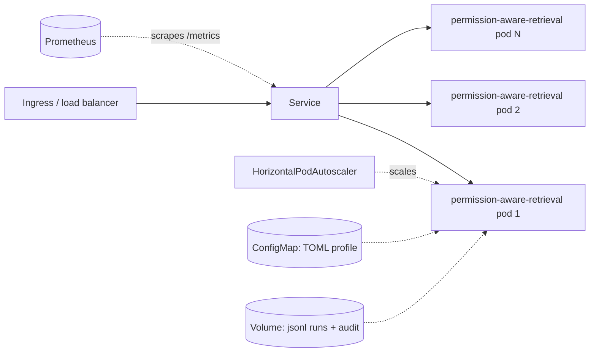

# Deployment

- Stateless replicas behind a Service; scale on CPU via HPA.
- Configuration is a TOML profile mounted from a ConfigMap and selected with `PERMISSION_AWARE_RETRIEVAL_CONFIG`.
- Readiness uses `/readyz`; liveness uses `/healthz`.
- PodDisruptionBudget keeps at least one replica during voluntary disruptions.
- NetworkPolicy allows ingress only from the gateway namespace.
